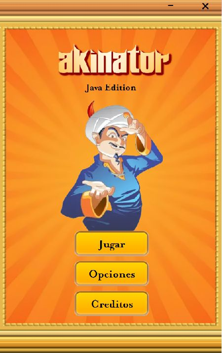
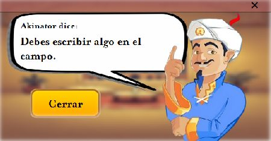

<p align="center">
  
</p>

# Akinator – Java Edition

Piensa en un actor y deja que Akinator intente adivinarlo con preguntas de sí o no.

## ¿Qué es?

Es un juego de adivinanzas sobre actores. Si Akinator no acierta, puedes enseñarle el personaje y una pregunta que lo diferencie. El juego guarda actores y preguntas en un árbol binario sencillo dentro de `arbolActores.txt`.

### ¿Cómo funciona `arbolActores.txt`?

El archivo guarda el árbol en **postorden**: primero aparece la rama de **Sí**, después la rama de **No** y al final la pregunta que las conecta. Al iniciar el juego, Akinator lee esas líneas y reconstruye el árbol en memoria.

- Una línea que comienza con `¿` representa una pregunta y conecta dos ramas.
- Una línea que no comienza con `¿` representa el nombre de un actor al que se llega al final de una rama.
- Si la respuesta es **Sí**, el juego sigue la rama izquierda; si es **No**, sigue la rama derecha.

Por ejemplo, estas tres líneas representan una pregunta con dos posibles respuestas:

```text
Actor A
Actor B
¿Es una persona ficticia?
```

La respuesta **Sí** lleva a «Actor A» y **No** lleva a «Actor B». Es importante conservar este orden. Al aprender un actor nuevo, el juego reemplaza la hoja correspondiente por la pregunta que lo diferencia y guarda el árbol actualizado en `arbolActores.txt`. Las preguntas deben comenzar con `¿` y terminar con `?`; los nombres de actores no deben comenzar con `¿`, porque ese signo identifica las preguntas.

## Funciones

- Música y efectos de sonido con volumen ajustable.
- Animaciones activables y opción para fijar la ventana.
- Restablecimiento de las opciones y expresiones de Akinator durante la partida.
- Foto del actor obtenida desde Wikipedia. Requiere conexión a internet; si no hay conexión, se muestra la imagen de respaldo.
- Pantalla de créditos con las fotos de perfil de GitHub, enlaces a GitHub y LinkedIn de los autores y acceso al repositorio. Las fotos requieren conexión; si no cargan, se muestran las iniciales.

## Capturas

<table>
  <tr>
    <td align="center"><strong>Menú</strong><br></td>
    <td align="center"><strong>Partida</strong><br></td>
  </tr>
  <tr>
    <td align="center"><strong>Resultado</strong><br></td>
    <td align="center"><strong>Enseñar un personaje</strong><br></td>
  </tr>
  <tr>
    <td align="center"><strong>Alerta</strong><br></td>
    <td align="center"><strong>Opciones</strong><br></td>
  </tr>
</table>

## Cómo jugar

1. Pulsa **Jugar**.
2. Responde **Sí** o **No** a cada pregunta.
3. Confirma si Akinator acertó. Si no, escribe el actor y una pregunta que permita distinguirlo.

## Cómo ejecutarlo

Necesitas **Java 21 (JDK)** y **Maven**.

**Opción A: iniciar desde Maven**

```bash
mvn clean javafx:run
```

**Opción B: crear y ejecutar el JAR**

```bash
mvn clean package
java -jar target/AkinatorProyecto-1.0.0.jar
```

Ejecuta el segundo comando desde la carpeta raíz del proyecto, donde está `arbolActores.txt`. Maven coloca las librerías de JavaFX en `target/lib/`, junto al JAR. Para distribuir el juego, conserva la carpeta `lib/` junto al JAR y coloca `arbolActores.txt` en la carpeta desde la que se inicia el programa.

## Limitaciones conocidas

- El JAR necesita ejecutarse desde la carpeta que contiene `arbolActores.txt`; el ZIP de distribución incluye ese archivo junto al JAR.
- La pantalla para enseñar un personaje nuevo todavía no tiene un botón para volver al menú.
- El formato del contador de preguntas no es consistente: algunos textos muestran, por ejemplo, `Pregunta N° 1` y otros `Pregunta N°3`.
- Las fotos del actor desde Wikipedia y las fotos de perfil de GitHub requieren conexión a internet. La pantalla de créditos muestra iniciales si los perfiles no están disponibles.

## Estructura del proyecto

- `src/main/java/`: lógica del juego y pantallas.
- `src/main/resources/`: imágenes, sonidos, estilos y diseños de las pantallas.
- `arbolActores.txt`: actores y preguntas que usa el juego.

## Autores

**Fabián Rodas y Paula Benalcázar** — proyecto académico de 2025 de la Universidad de Especialidades Espíritu Santo (UEES). Los arreglos y la documentación de esta versión corresponden a 2026.

## Aviso y licencia

Este es un proyecto académico no oficial y no tiene relación con Elokence. “Akinator”, su personaje y las imágenes asociadas pertenecen a Elokence. La música, los efectos y otros recursos pertenecen a sus respectivos titulares y no están cubiertos por la licencia del código.

El código de este proyecto se distribuye bajo la licencia MIT; esta licencia no cubre las marcas ni los recursos de terceros. Consulta el archivo [LICENSE](LICENSE).
